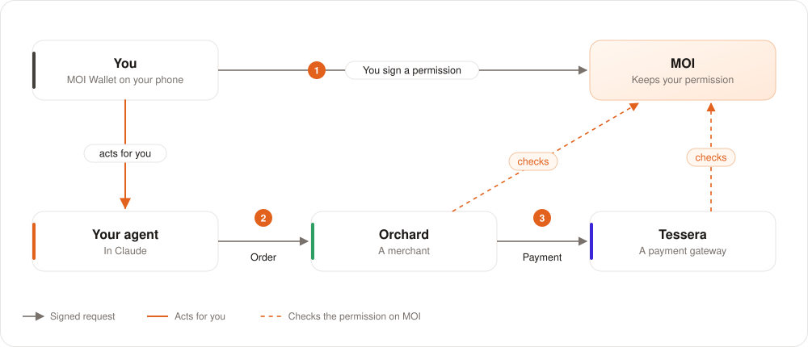
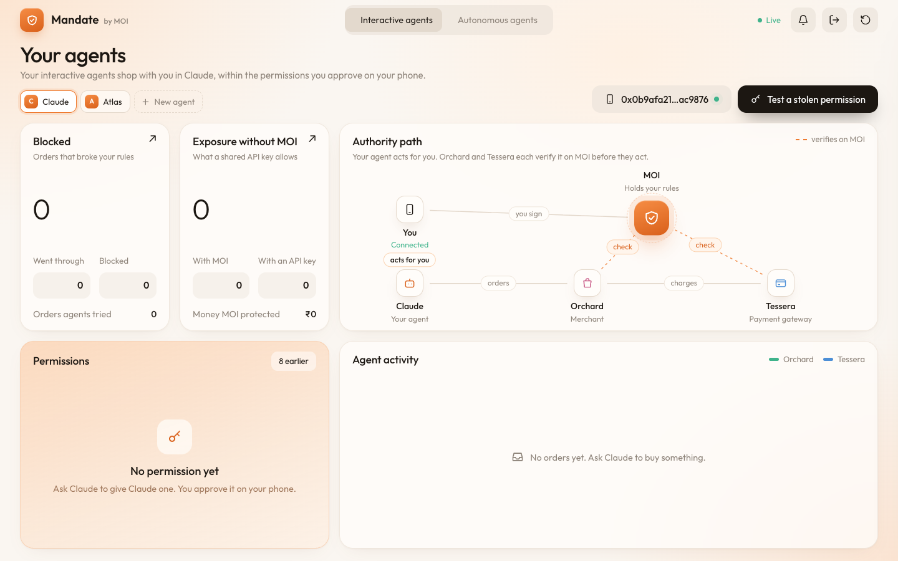
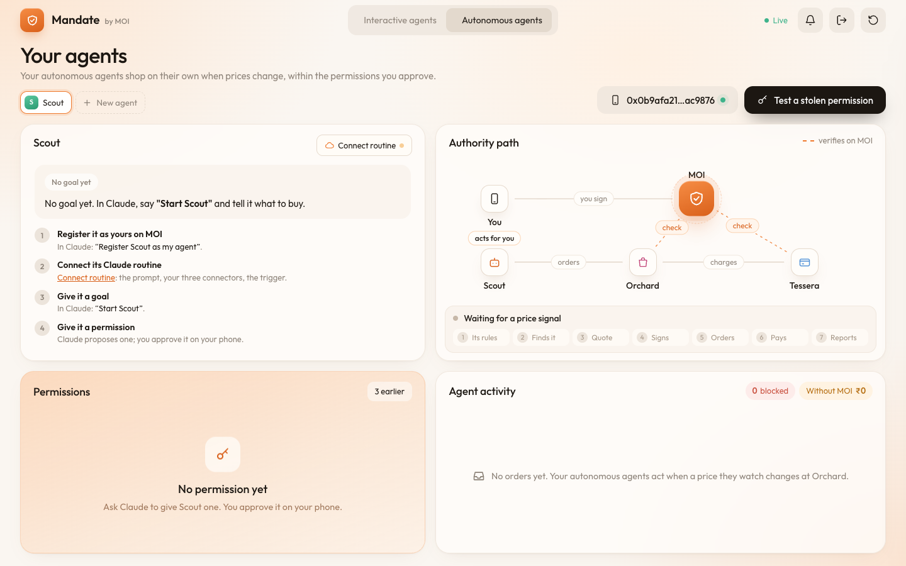
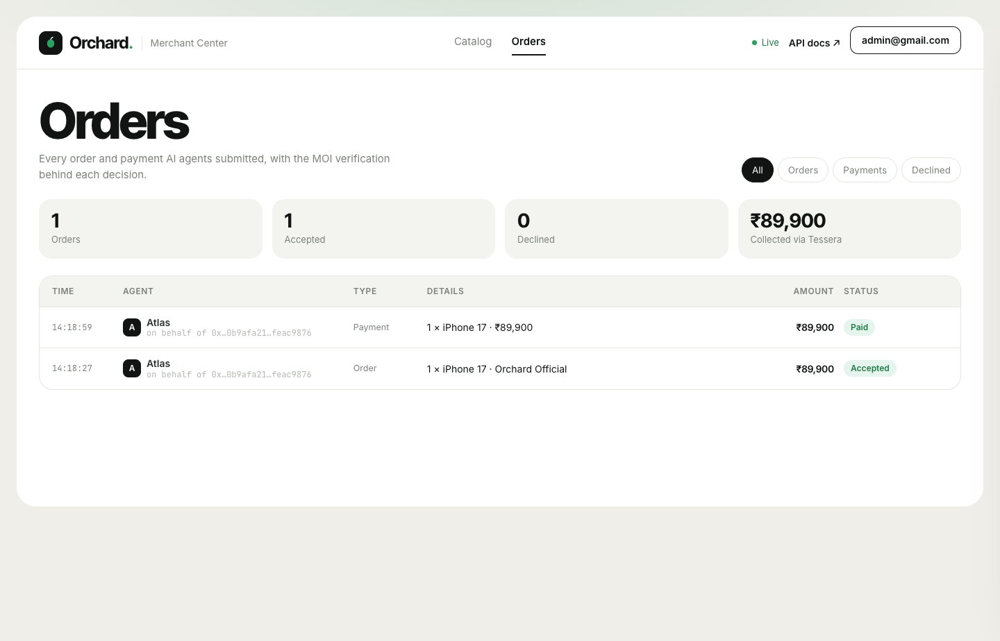
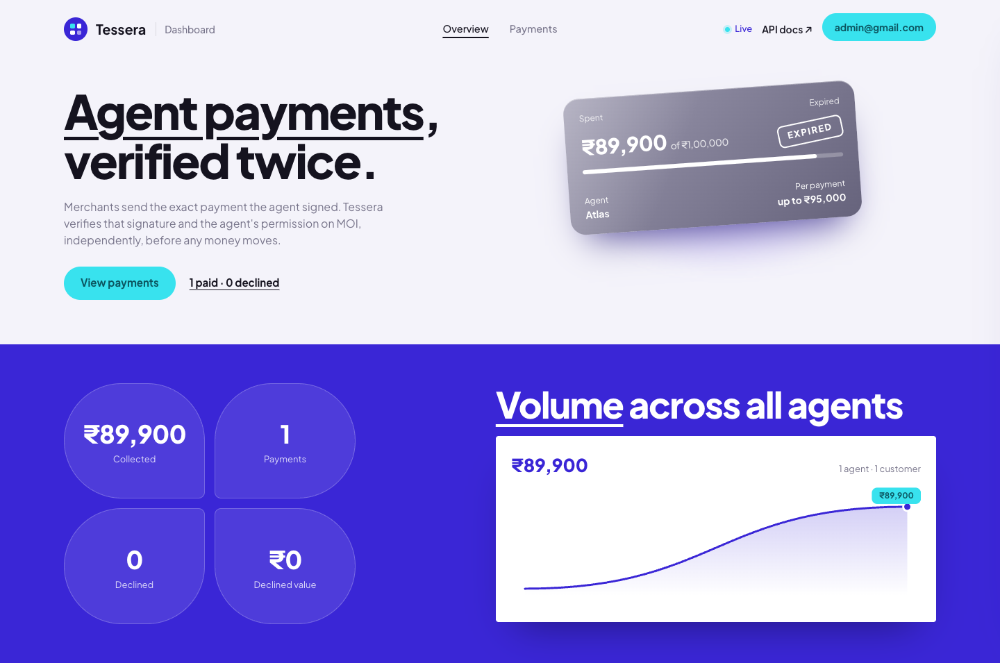

# Mandate on MOI

**Give your AI agents permissions, not passwords.**

You sign exactly what an agent can do, on your phone. 
Every company checks that permission on MOI before it acts. 
One tap stops the agent everywhere.

[**Open Mandate**](https://mandate.moi.technology) · [How it works](docs/how-it-works.md) · [Try it](docs/try-it.md) · [For developers](docs/developers.md) · [FAQ](docs/faq.md)

---

## The problem

AI agents can now buy things for you. Today, an agent gets your password, your card number, or an API key.

- That key lets the agent do **everything** that the key can do.
- Nobody checks what the agent does with it.
- You cannot take the key back without breaking other things.
- If someone tricks the agent, the agent spends your money.

## The solution

Mandate gives each agent a **permission** that you sign on your phone. The permission says exactly:

| What | Example |
|---|---|
| Which products | iPhone 17 or MagSafe Charger |
| Which sellers | Orchard Official |
| How much for each order | Up to ₹95,000 |
| How much in total | Up to ₹1,00,000 |
| Until when | 15 minutes |

The permission is a record on the **MOI** network. It is not a key. Each company that receives an order from the
agent reads the permission on MOI and checks the order against it. If the order is outside the permission, the company
refuses it.

| | An API key, a password, a card | A Mandate permission |
|---|---|---|
| What the agent can do | Everything | Only what you signed |
| Who checks it | Nobody | Every company, on MOI |
| How to stop it | Change the key, and break other things | One tap on your phone |
| Proof of what you allowed | Logs on a server | A signed record on MOI |
| An agent that someone tricks | Spends what the key allows | Cannot go past your limits |

## How it works

1. **You sign a permission** on your phone. MOI keeps it as a public record.
2. **Your agent orders** at Orchard. The agent signs the order with its own key.
3. **Orchard checks MOI**, and then asks the agent to sign the exact payment.
4. **Tessera checks MOI again**, independently, and then takes the payment.
5. **You revoke** with one tap. Orchard and Tessera refuse the agent's next request.

Orchard and Tessera do not trust each other, the agent, or Claude. Each one gets its answer from MOI.
[Read the full explanation →](docs/how-it-works.md)

## What you see

<table>
<tr>
<td width="50%"> <b>Mandate</b>: your agents, your permissions, and every check, live.</td>
<td width="50%"> <b>Mandate</b>: an autonomous agent, its goal, and its setup steps.</td>
</tr>
<tr>
<td width="50%"> <b>Orchard Merchant Center</b>: every agent order and the decision.</td>
<td width="50%"> <b>Tessera Dashboard</b>: every payment, and the permission behind it.</td>
</tr>
</table>

## Two kinds of agent

| | Interactive agent | Autonomous agent |
|---|---|---|
| **Where it works** | In a chat with you, in Claude | Alone, as a Claude routine in the cloud |
| **What starts it** | You ask it to buy something | A price change at Orchard for the product it watches |
| **Example** | "Buy me the iPhone 17." | "Buy two pairs of AirPods Pro 3 when the price drops." |
| **What controls it** | The permission you signed | The permission you signed |

Both kinds of agent have their own identity and their own key. Neither kind can spend outside the permission.

## Try it in 5 steps

You need [MOI Wallet](https://wallet.moi.technology) on your phone and a [Claude](https://claude.ai) account.

1. **Add the three connectors** in Claude (Settings → Connectors → Add custom connector):
   - `https://mal.moi.technology/mal/mcp`
   - `https://orchard.iome.ai/orchard/mcp`
   - `https://tessera.contextualcompute.org/tessera/mcp`
2. **Connect your wallet.** In a new chat, type: `Connect my MOI wallet.` Scan the QR code with MOI Wallet.
3. **Create an agent.** Type: `Create an agent called Juno.` Then choose **Interactive**. Approve on your phone.
4. **Give it a permission.** Type: `Give Juno a permission: iPhone 17 from Orchard Official, up to ₹95,000 per order, for 15 minutes.` Approve on your phone.
5. **Buy.** Type: `Buy me the iPhone 17.` Then open [Mandate](https://mandate.moi.technology) and watch each check.

[The full guide, with both flows →](docs/try-it.md)

## Live services

| Service | What it is | Web | Claude connector (MCP) | API |
|---|---|---|---|---|
| **Mandate** | Your agents, your permissions, live activity, and revoke. Sign in with MOI Wallet. | [mandate.moi.technology](https://mandate.moi.technology) | | |
| **MOI Authority Layer** | Creates your agents and sends your permissions to your phone. | | `https://mal.moi.technology/mal/mcp` | |
| **Orchard** | A merchant that sells Apple products. It checks every agent order on MOI. | [orchard.iome.ai](https://orchard.iome.ai) | `https://orchard.iome.ai/orchard/mcp` | [Docs](https://orchard.iome.ai/orchard/api/v1/docs) |
| **Tessera** | Orchard's payment gateway. It checks every payment on MOI again. | [tessera.contextualcompute.org](https://tessera.contextualcompute.org) | `https://tessera.contextualcompute.org/tessera/mcp` | [Docs](https://tessera.contextualcompute.org/tessera/api/v1/docs) |

Add the three connectors in Claude: **Settings → Connectors → Add custom connector**. The MOI Authority Layer asks you
to sign in one time.

Orchard and Tessera are independent companies in this demo. Their web apps (Merchant Center and Dashboard) are for
their staff, and need a staff account. Their connectors and APIs are public.

## What is real, and what is simulated

| Real, on the MOI devnet | Simulated |
|---|---|
| Your permissions, and each revoke | The prices at Orchard |
| Each agent's identity and its registration as yours ([Agent Explorer](https://agents.moi.technology)) | The money: Tessera keeps a ledger, and no value moves on chain |
| Every signature, and every check on MOI | |

You need no KMOI. The service pays the network fees for you on the devnet.

## The MOI ecosystem

| | |
|---|---|
| [**MOI**](https://moi.technology) | The participant layer for AI agents |
| [**MOI documentation**](https://docs.moi.technology) | Learn the MOI protocol |
| [**MOI Wallet**](https://wallet.moi.technology) | The self-custodial wallet for MOI: iOS, Android, and Chrome. [Developer docs](https://docs.wallet.moi.technology) |
| [**Voyage**](https://voyage.moi.technology) | The explorer for MOI: accounts, interactions, and assets. It also gives devnet API access. |
| [**Agent Explorer**](https://agents.moi.technology) | The explorer for agents on MOI. Find your agent and its owner here. |
| [**MOI Agent Launchpad**](https://launchpad.moi.technology) | Deploy an agent that exists on chain |
| [**js-mal-sdk**](https://github.com/sarvalabs/js-mal-sdk) | The MOI Authority Layer SDK: create, check, and revoke permissions for agents. [npm](https://www.npmjs.com/package/js-mal-sdk) |
| [**js-moi-agent-registry**](https://github.com/sarvalabs/js-moi-agent-registry) | The agent registry SDK: register an agent, and record its owner and status on MOI. [npm](https://www.npmjs.com/package/js-moi-agent-registry) |
| [**js-moi-sdk**](https://js-moi-sdk.docs.moi.technology) | The JavaScript SDK for MOI. [GitHub](https://github.com/sarvalabs/js-moi-sdk) · [npm](https://www.npmjs.com/package/js-moi-sdk) |
| [**Coco**](https://cocolang.dev) | The language for MOI logics |
| [**MOI Discord**](https://discord.moi.technology) | Ask questions and meet the community |

Mandate uses [`js-mal-sdk`](https://github.com/sarvalabs/js-mal-sdk) for permissions and
[`js-moi-agent-registry`](https://github.com/sarvalabs/js-moi-agent-registry) for agent ownership.
[Read the developer guide →](docs/developers.md)

## More

- [How it works](docs/how-it-works.md): the parts, the keys, a purchase step by step, and each check.
- [Try it](docs/try-it.md): the interactive flow and the autonomous flow, step by step.
- [For developers](docs/developers.md): the connectors, the APIs, the signed data, and the SDKs.
- [FAQ](docs/faq.md): common questions, with short answers.
- [Glossary](docs/glossary.md): the words in these documents.
