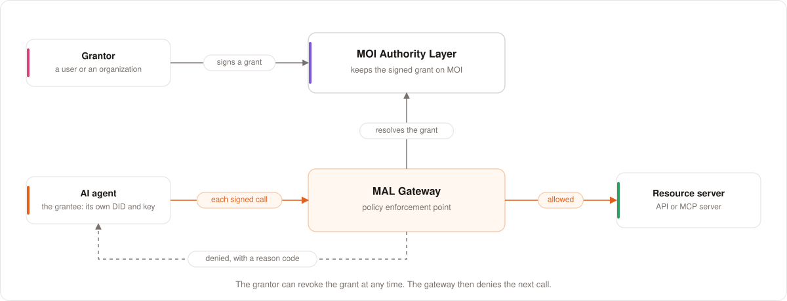
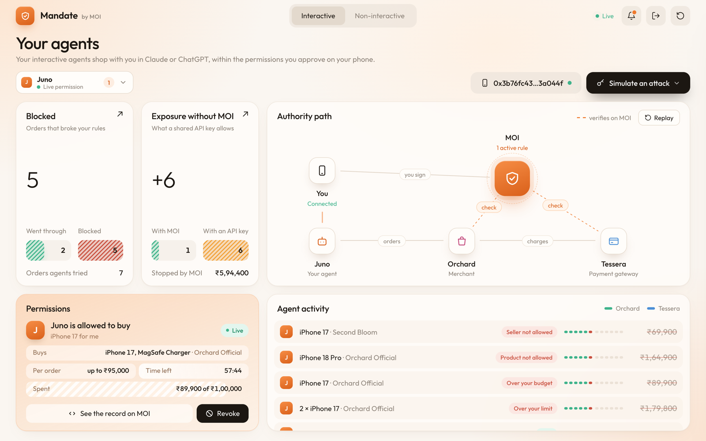
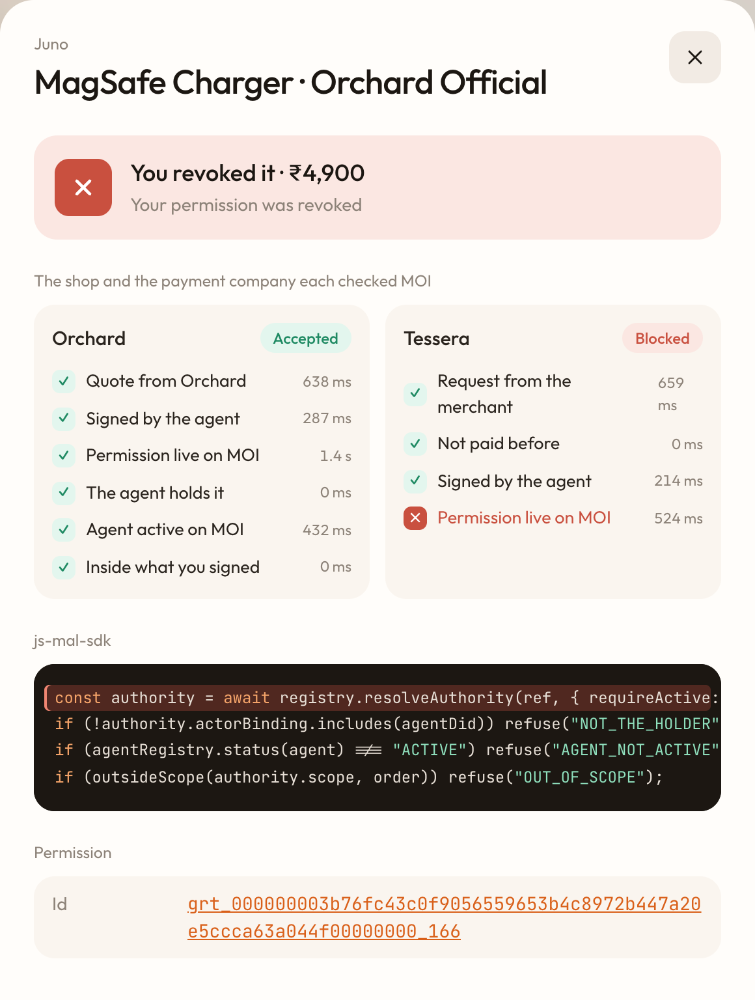
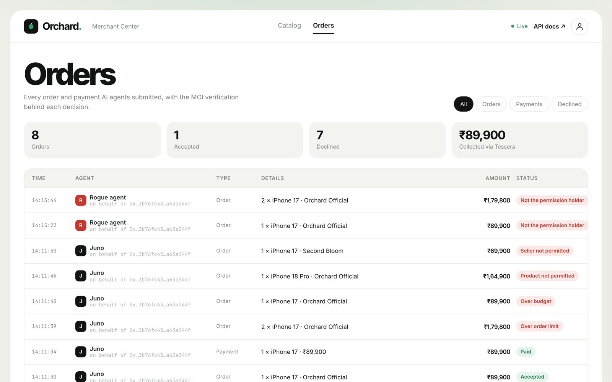
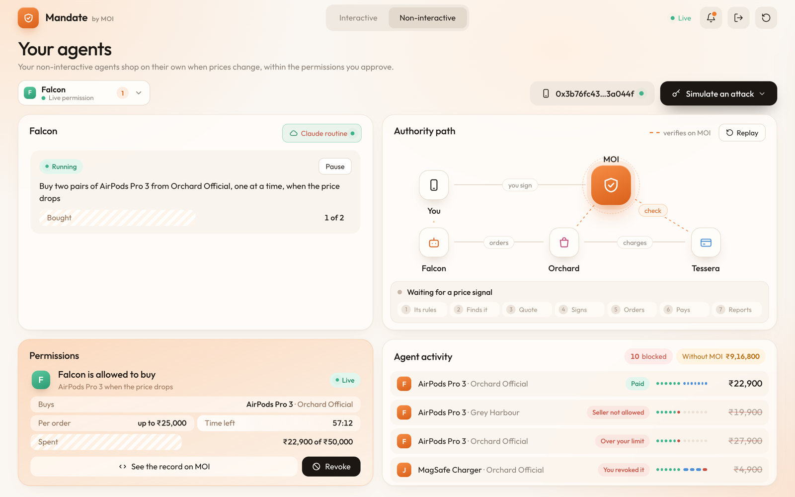

# Mandate on MOI

**Give your AI agents permissions, not passwords.**

A user or an organization signs what an agent can do. 
Each action of the agent is checked against it. 
One revoke stops the agent everywhere.

[**Open Mandate**](https://mandate.demo.moi.technology) · [Why agents need authority](docs/why-agents-need-authority.md) · [MOI Authority Layer](docs/moi-authority-layer.md) · [MAL Gateway](docs/mal-gateway.md) · [Walkthrough](docs/walkthrough.md)

---

## The problem

AI agents now act for users and organizations. They read data, approve requests, place orders and make payments.

Today, an agent gets access with a password, an API key or a token. A key opens every door that its owner can open. The service sees a valid key. It does not see what the user asked for.

Thus, an agent that must buy one charger can buy two laptops. An agent that must read one record can read all the records. If a prompt injection tricks the agent, the key allows that too.

## The solution: a permission, and a gateway that checks it

MOI gives each agent its own identity (a DID) and a registered owner. Then two parts control what the agent can do.

| | **MOI Authority Layer (MAL)** | **MAL Gateway** |
|---|---|---|
| **Its job** | It records what an agent can do. | It checks each agent call against that record. |
| **How** | The grantor, a user or an organization, signs a permission, called a *grant*. The MOI network keeps it as a public record. | All agent calls go through the gateway. The gateway checks each call before the call gets to the resource server. |
| **The result** | Any verifier can check the grant in one call. Only the grantor can revoke it. | A resource server gets only the calls that the grant allows. Each decision goes into an audit log. |

MAL is the source of authority. The gateway is the policy enforcement point.

## An example

You give your agent, Juno, this permission: *"Buy an iPhone 17 from Orchard Official. Spend a maximum of ₹95,000 for each order and ₹1,00,000 in total. Stop after one hour."*

| Juno tries to | Result |
|---|---|
| Buy one iPhone 17 for ₹89,900 | **Allowed** |
| Buy two iPhone 17s for ₹1,79,800 | **Refused.** The order is more than ₹95,000. |
| Buy a phone from a different seller | **Refused.** The seller is not in the permission. |
| Pay after you revoke the permission | **Refused.** The permission is revoked. |

The model can make a mistake. A web page can try to trick it. The result does not change, because the limits are on MOI, not in the model.

Shopping is only the example. A permission can also name data tables, expense limits or any other action.

## Who gets what

| For | What they get |
|---|---|
| **Grantors**: users and organizations that deploy agents | Control. They set exact limits, stop an agent with one revoke, and get a record of each action. |
| **Resource servers**: the APIs and MCP servers that agents call | Proof. Each call comes with a grant that the grantor signed. The server never gives its credentials to an agent. |
| **Agent developers and platform teams** | One policy enforcement point, not custom checks in each service. The gateway runs as a managed service or self-hosted in your own infrastructure. |

## The demo: Mandate

Mandate shows MAL with a real flow. An agent buys from a shop, Orchard, and pays through a payment service, Tessera. We use money because a limit on money is easy to see.

<table>
<tr>
<td width="50%"> <b>Mandate.</b> Your agents, your permissions and each decision, live.</td>
<td width="50%"> <b>A revoke during a purchase.</b> Orchard accepted the order. Then the payment was refused.</td>
</tr>
<tr>
<td width="50%"> <b>Orchard Merchant Center.</b> The shop sees each agent order, and the reason for each decision.</td>
<td width="50%"> <b>An agent that works alone.</b> Falcon reacts to price changes, inside its limits.</td>
</tr>
</table>

| | What it is | Link |
|---|---|---|
| **Mandate** | Shows your agents, your permissions and each decision. You can revoke here. Sign in with MOI Wallet. | [mandate.demo.moi.technology](https://mandate.demo.moi.technology) |
| **MOI Authority Layer** | The connector for Claude and ChatGPT. It makes your agents and sends your permissions to your phone. | `https://mal.demo.moi.technology/mcp` |
| **Orchard** | A shop that sells Apple products. It has an MCP connector, a REST API and a merchant console. | [orchard.demo.moi.technology](https://orchard.demo.moi.technology) · [API](https://orchard.demo.moi.technology/api/v1/docs) |
| **Tessera** | The payment gateway of Orchard. It has an MCP connector, a REST API and an operations console. | [tessera.demo.moi.technology](https://tessera.demo.moi.technology) · [API](https://tessera.demo.moi.technology/api/v1/docs) |

Orchard and Tessera are two independent organizations. They do not trust each other, the agent or the AI model.

| Real, on the MOI public devnet | Simulated |
|---|---|
| Your permissions and each revoke | The prices at Orchard |
| The identity of each agent, and its registration to you ([Agent Explorer](https://agents.moi.technology)) | The money. Tessera keeps a ledger. No value moves on chain. |
| Each signature, and each check against MOI | |

## Try it

You need [MOI Wallet](https://wallet.moi.technology) on your phone, with a public devnet account. You also need a [Claude](https://claude.ai) or [ChatGPT](https://chatgpt.com) account that can add custom connectors. You do not need KMOI. The service pays the fees.

1. **Add the three connectors.** In Claude, go to Settings → Plugin → Browser Plugins → Add custom connector. Add each URL:
   `https://mal.demo.moi.technology/mcp`, `https://orchard.demo.moi.technology/mcp`, `https://tessera.demo.moi.technology/mcp`
2. **Connect your wallet.** In a new chat, type `Connect my MOI wallet.` Then scan the QR code with MOI Wallet.
3. **Make an agent.** Type `Create an agent called Juno.` Select **Interactive**. Then approve on your phone.
4. **Give it a permission.** Type `Give Juno a permission: iPhone 17 from Orchard Official, up to ₹95,000 per order and ₹1,00,000 in total, for one hour.` Then approve on your phone.
5. **Buy.** Type `Buy me the iPhone 17.` Then open [Mandate](https://mandate.demo.moi.technology) to see the result. Click **Replay** to see it again.

The [walkthrough](docs/walkthrough.md) shows more: the limits, an attack, a revoke during a purchase, and an agent that works alone.

## Read more

**The foundations**

| | |
|---|---|
| **1. [Why agents need authority](docs/why-agents-need-authority.md)** | The three questions about each agent, and why keys and tokens cannot answer them. |
| **2. [The MOI Authority Layer](docs/moi-authority-layer.md)** | Where the permission lives, how a verifier checks it, and how the grantor revokes it. |
| **3. [The MAL Gateway](docs/mal-gateway.md)** | How the gateway checks each call in seven steps, and where it runs. |

**The demo**

| | |
|---|---|
| **4. [How it works](docs/how-it-works.md)** | The life of one agent in Mandate, step by step. |
| **5. [Walkthrough](docs/walkthrough.md)** | Each step on screen, with each prompt to try. |

**Build with it**

| | |
|---|---|
| **6. [For developers](docs/developers.md)** | The SDKs, the connectors, the APIs, the signed data and the refusal codes. |

[FAQ](docs/faq.md) · [Glossary](docs/glossary.md)

## The MOI ecosystem

| | |
|---|---|
| [**MOI**](https://moi.technology) | The participant layer for AI agents |
| [**MOI documentation**](https://docs.moi.technology) | The MOI protocol |
| [**MOI Wallet**](https://wallet.moi.technology) | The self-custodial wallet for MOI, for iOS, Android and Chrome. [Developer docs](https://docs.wallet.moi.technology) |
| [**Voyage**](https://voyage.moi.technology) | The explorer for MOI: accounts, interactions and assets |
| [**Agent Explorer**](https://agents.moi.technology) | Each agent on MOI, and its owner |
| [**MOI Agent Launchpad**](https://launchpad.moi.technology) | Deploy an agent that has an identity on chain |
| [**js-mal-sdk**](https://github.com/sarvalabs/js-mal-sdk) | The SDK for the MOI Authority Layer. Grant, delegate, revoke and verify permissions for agents. [npm](https://www.npmjs.com/package/js-mal-sdk) |
| [**js-moi-agent-registry**](https://github.com/sarvalabs/js-moi-agent-registry) | The SDK for the agent registry. Register an agent, and record its owner and status on MOI. [npm](https://www.npmjs.com/package/js-moi-agent-registry) |
| [**js-moi-sdk**](https://js-moi-sdk.docs.moi.technology) | The JavaScript SDK for MOI. [GitHub](https://github.com/sarvalabs/js-moi-sdk) · [npm](https://www.npmjs.com/package/js-moi-sdk) |
| [**Coco**](https://cocolang.dev) | The language for MOI logics |
| [**MOI Discord**](https://discord.moi.technology) | Questions and the community |
