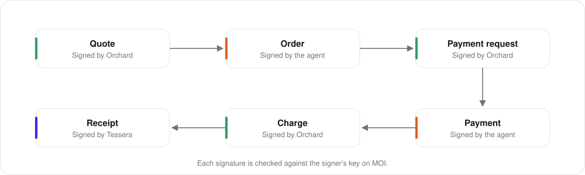

# For developers

[← Back to the overview](../README.md)

This page lists the connectors, the APIs, the signed data, and the SDKs that Mandate uses.

## The stack

| Layer | What Mandate uses |
|---|---|
| Network | The MOI devnet ([Voyage](https://voyage.moi.technology) shows its accounts and interactions; the [Agent Explorer](https://agents.moi.technology) shows its agents) |
| Permissions | [`js-mal-sdk`](https://github.com/sarvalabs/js-mal-sdk) ([npm](https://www.npmjs.com/package/js-mal-sdk)): the MOI Authority Layer protocol |
| Agent ownership | [`js-moi-agent-registry`](https://github.com/sarvalabs/js-moi-agent-registry) ([npm](https://www.npmjs.com/package/js-moi-agent-registry)): the agent registry |
| MOI access | [`js-moi-sdk`](https://js-moi-sdk.docs.moi.technology) ([GitHub](https://github.com/sarvalabs/js-moi-sdk) · [npm](https://www.npmjs.com/package/js-moi-sdk)) |
| Phone signing | MOI Wallet over WalletConnect: `moi.signInteraction` and `moi.sign` ([wallet docs](https://docs.wallet.moi.technology)) |
| Agents | Claude, through MCP connectors ([Model Context Protocol](https://modelcontextprotocol.io)) |
| Services | Node.js 22 and TypeScript |

### Install the SDKs

```sh
npm install js-mal-sdk js-moi-agent-registry js-moi-sdk
```

| Package | GitHub | npm |
|---|---|---|
| `js-mal-sdk` | [sarvalabs/js-mal-sdk](https://github.com/sarvalabs/js-mal-sdk) | [js-mal-sdk](https://www.npmjs.com/package/js-mal-sdk) |
| `js-moi-agent-registry` | [sarvalabs/js-moi-agent-registry](https://github.com/sarvalabs/js-moi-agent-registry) | [js-moi-agent-registry](https://www.npmjs.com/package/js-moi-agent-registry) |
| `js-moi-sdk` | [sarvalabs/js-moi-sdk](https://github.com/sarvalabs/js-moi-sdk) | [js-moi-sdk](https://www.npmjs.com/package/js-moi-sdk) |

### Logics on the MOI devnet

| Logic | ID |
|---|---|
| Authority registry (permissions) | `0x20000000da714779e4a5a3e9aad5e280ce90a026757ef8ca0c2a8d2400000000` |
| MOI identity | `0x20000000928c74bb345d4bdc726dfe22ed485742c6640a9df86d71b300000000` |
| Agent registry | `0x2000000097efdc0a58e8a28f2968ea414d6b26efdbf7baee96c7ff8600000000` |

You can find each ID on [Voyage](https://voyage.moi.technology). The [Agent Explorer](https://agents.moi.technology)
shows the agents in the agent registry.

## The check, in code

Each company runs this check on its own, with its own connection to MOI:

```ts
import { AuthorityRegistry } from "js-mal-sdk";
import { AgentRegistry } from "js-moi-agent-registry";

// 1. Is the permission live, right now?
const authority = await registry.resolveAuthority(order.ref, { requireActive: true });

// 2. Does this agent hold it?
if (!authority.actorBinding.includes(order.agentDid)) refuse("NOT_THE_HOLDER");

// 3. Did its owner register it, and is it active?
const { profile } = await agentRegistry.getAgentProfile(order.agentRegistryId);
if (profile.agent_wallet !== agentAccount || profile.status !== "ACTIVE") refuse("AGENT_NOT_ACTIVE");

// 4. Is the order inside the permission?
if (outsideScope(authority.scope, order)) refuse("OUT_OF_SCOPE");
```

The check does not compare the agent's owner with the person who gave the permission. Any person can give a
permission to any agent. The person who gives the permission decides its limits. The agent's owner decides only if
the agent is active.

## A permission on MOI

A permission is a **grant** in the authority registry. Your phone signs it. This is the data:

```json
{
  "context": "iPhone 17 for me",
  "grantorDid": "did:moi:<your account>",
  "grantees": ["did:moi:<the agent's account>"],
  "scope": [
    {
      "resource": "shop:order",
      "actions": ["buy"],
      "constraints": {
        "sellers": { "kind": "strings", "value": ["orchard-official"] },
        "products": { "kind": "strings", "value": ["iphone-17", "magsafe-charger"] },
        "max_amount": { "kind": "number", "value": 95000 },
        "max_total": { "kind": "number", "value": 100000 }
      }
    },
    {
      "resource": "pay:charge",
      "actions": ["pay"],
      "constraints": {
        "payees": { "kind": "strings", "value": ["orchard"] },
        "max_amount": { "kind": "number", "value": 95000 },
        "max_total": { "kind": "number", "value": 100000 }
      }
    }
  ],
  "maxDelegationDepth": 0,
  "expiresAt": 1793330000
}
```

## The signed data between the services

<p align="center"></p>

| Data | Signed by | Holds |
|---|---|---|
| Quote | Orchard | Product, seller, price, quantity, the buyer agent, the expiry (5 minutes) |
| Order | The agent | The quote, the permission ID, the agent's identity and registry ID, a nonce |
| Payment request | Orchard | The order, the amount, the payee, the permission ID, the expiry |
| Payment | The agent | The payment request, the agent's identity and registry ID |
| Charge | Orchard | The payment |
| Receipt | Tessera | The amount, the payee, the payer, the agent |

Each signature is checked against the signer's key on MOI.

## The connectors (MCP)

**MOI Authority Layer**: `https://mal.demo.moi.technology/mcp` (OAuth sign-in)

| For you | What it does |
|---|---|
| `connect_wallet`, `wait_for_wallet` | Connects MOI Wallet and proves your account |
| `create_agent` | Creates an agent, and asks your phone to register it as yours |
| `register_agent` | Registers an existing agent as yours |
| `list_agents`, `use_agent` | Lists your agents, and selects the agent for this chat |
| `create_grant`, `send_grant`, `check_approval` | Proposes a permission, sends it to your phone, and waits for your answer |
| `revoke` | Revokes a permission |
| `start_agent`, `stop_agent`, `resume_agent` | Gives an autonomous agent its goal, and pauses or resumes it |
| `retire_agent` | Revokes its permissions and marks it deprecated in the agent registry |
| `my_permissions`, `history` | Your permissions and their records on MOI |

| For agents | What it does |
|---|---|
| `my_authority` | The agent's identity, permissions, and goal |
| `sign_order`, `sign_payment` | Signs an order or a payment with the agent's own key |
| `report_run` | Ends a routine run with a report |

**Orchard**: `https://orchard.demo.moi.technology/mcp`: `search_products`, `get_quote`, `place_order`, `confirm_payment`

**Tessera**: `https://tessera.demo.moi.technology/mcp`: `spend_summary`, `get_receipt`

## The APIs (REST)

Orchard and Tessera also have REST APIs, with OpenAPI 3.1 references:

- [Orchard API](https://orchard.demo.moi.technology/api/v1/docs): products, listings, quotes, orders, payments
- [Tessera API](https://tessera.demo.moi.technology/api/v1/docs): charges, receipts

A refusal is a normal answer, not an HTTP error. It has a `code` and a `reason`.

## Refusal codes

| Code | Meaning |
|---|---|
| `NO_PERMISSION` | The agent has no permission |
| `GRANT_REVOKED`, `GRANT_EXPIRED` | You revoked the permission, or its time ended |
| `NOT_THE_HOLDER` | The permission is for a different agent |
| `AGENT_NOT_REGISTERED` | The owner did not register the agent in the agent registry |
| `AGENT_NOT_ACTIVE` | The owner paused or retired the agent |
| `OUT_OF_SCOPE` | The product, the seller, the amount, or the budget is outside the permission |
| `BAD_SIGNATURE`, `WRONG_SIGNER` | A signature does not match the account |
| `QUOTE_EXPIRED`, `REPLAY` | The quote is old, or the order or payment was used before |
| `MOI_UNREACHABLE` | MOI did not answer. Try again. |

## The services

Mandate runs as five services. Only the gateway is public.

| Service | Port | What it does |
|---|---|---|
| MOI Authority Layer | 8701 | The connector, the agents and their keys, the phone connection |
| Mandate | 8700 | The web app, and the start of autonomous runs |
| Orchard | 8702 | The merchant: connector, API, and Merchant Center |
| Tessera | 8703 | The payment gateway: connector, API, and Dashboard |
| Gateway | 8704 | The one public port. It keeps the internal routes private. |

[← Back to the overview](../README.md) · [FAQ →](faq.md)
