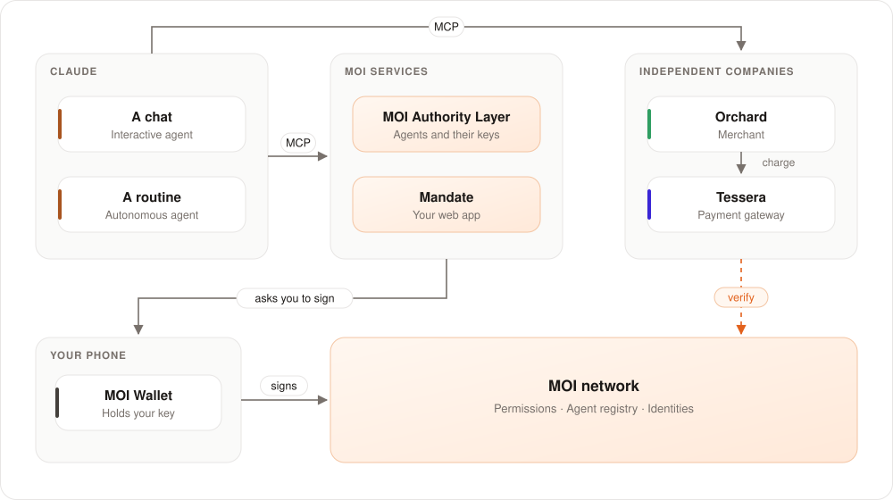
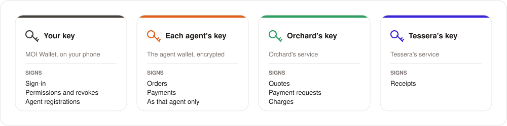
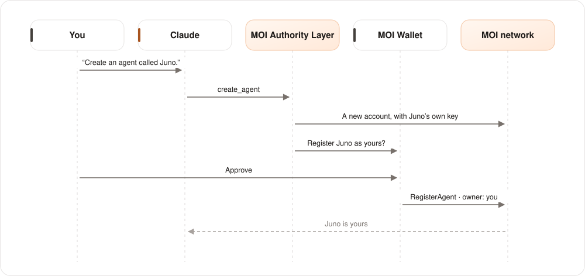
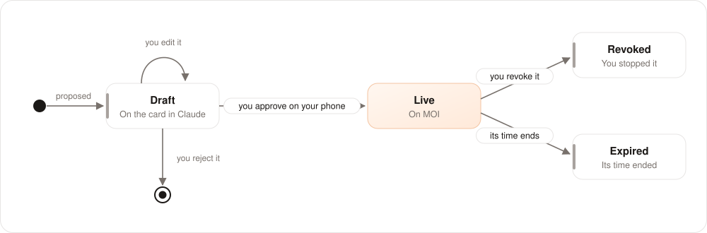
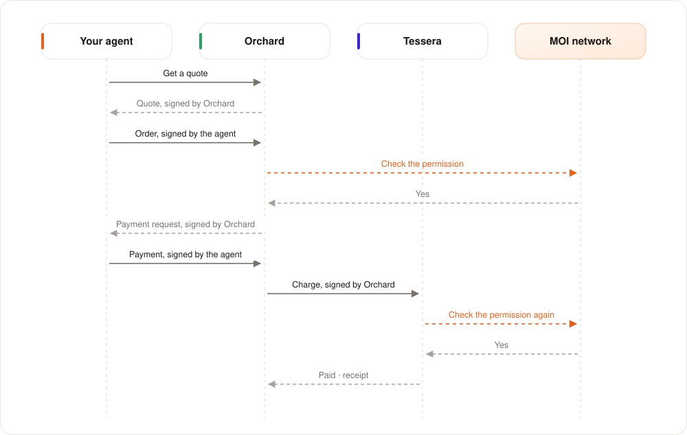
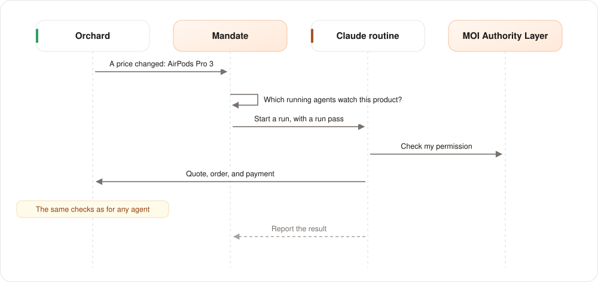

# How it works

[← Back to the overview](../README.md)

This page explains the parts of Mandate, the keys, and what happens in each step of a purchase.

## The parts

| Part | What it does |
|---|---|
| **MOI Wallet** | Holds your key on your phone. It signs your sign-in, your permissions, your revokes, and your agent registrations. |
| **MOI Authority Layer** | The Claude connector. It creates agents, keeps each agent's key, and sends each write to your phone to sign. |
| **Mandate** | The web app. It shows your agents, your permissions, and every check as it happens. You can revoke from it. |
| **Orchard** | A merchant. It gives quotes, takes orders, and checks each order on MOI. |
| **Tessera** | Orchard's payment gateway. It checks each payment on MOI again before it pays. |
| **MOI network** | Keeps the permissions, the agent registry, and the identities as public records. |

## Who holds which key

| Key | Where it is | What it signs |
|---|---|---|
| **Your key** | MOI Wallet, on your phone | Your sign-in, permissions, revokes, and agent registrations |
| **Each agent's key** | The agent wallet, encrypted. It never goes to Claude. | Orders and payments, as that agent only |
| **Orchard's key** | Orchard's service | Quotes and payment requests |
| **Tessera's key** | Tessera's service | Receipts |

Your key never leaves your phone. No service can sign as you.

## Step 1: You create an agent

- The service makes a new key and a new MOI account for the agent. The agent gets its own identity, `did:moi:…`.
- Your phone registers the agent in the **agent registry** on MOI. The registry records you as the owner. You can
  find the agent on the [Agent Explorer](https://agents.moi.technology).
- A new agent can do nothing. It has no permission yet.

## Step 2: You give a permission

1. Claude shows the permission on a card. You can change each value on the card.
2. You click **Send to my phone**. Your phone shows the request.
3. You approve. Your phone signs the permission, and MOI keeps it as a public record.

The card shows the permission in plain words. MOI Wallet shows the same request as encoded data. The card tells you
which request to look for on your phone.

## Step 3: The agent buys

A purchase works like a card payment. The shop asks for the payment, and the agent signs exactly that amount.

## The checks

Each company runs its own checks. One failed check stops the order or the payment, and the company tells the agent why.

**Orchard checks each order:**

| Check | Why |
|---|---|
| The quote is from Orchard, and it is not old | The agent cannot change the price |
| The agent signed the order | Nobody else can order as the agent |
| The permission is live on MOI | You did not revoke it, and its time did not end |
| The agent holds the permission | A stolen permission does not work for another agent |
| The agent is registered and active | Its owner did not pause or retire it |
| The order is inside the permission | Product, seller, amount for each order, and total budget |

**Tessera checks each payment again:**

| Check | Why |
|---|---|
| The charge is from a merchant that Tessera serves | Nobody can send a false charge |
| Tessera did not pay this request before | Nobody can pay twice |
| The agent signed exactly this payment | Nobody can change the amount or the payee |
| The permission is live, and the agent holds it | A revoke stops payments at once |
| The agent is registered and active | Its owner did not pause or retire it |
| The payment is inside the permission | The payee, the amount, and the budget |

## Step 4: You revoke

You tap **Revoke** in Mandate, or you tell Claude. Your phone signs the revoke, and MOI records it.

From the next request, Orchard and Tessera refuse the agent. You do not change a key. You do not call a company.
Nothing else stops working.

An example: an agent places an order. Orchard accepts it. You revoke. The agent then tries to pay. Tessera checks MOI
and refuses the payment, because the permission is revoked.

## Autonomous agents

An autonomous agent runs alone, as a Claude routine. A price change at Orchard starts it.

- You give the agent a goal in words, for example: "Buy two pairs of AirPods Pro 3 when the price drops."
- Only a price change for that product starts the agent. A new listing at Orchard also starts it.
- Each run gets a **run pass**. The pass lets that run act as that agent only, for 20 minutes.
- The agent stops when it reaches its goal. You can also pause it, or revoke its permission.

A price change can tempt the agent. A cheaper seller, or a listing that tries to trick it, can make it try. The
permission still decides. The model can make a mistake. The limits on MOI do not change.

## Fees

You need no KMOI. On the devnet, the service pays the network fees for your writes. It also keeps enough KMOI in your
account for the storage that your permissions use on MOI. The service never creates an account for you: you register
your account in MOI Wallet.

[← Back to the overview](../README.md) · [Try it →](try-it.md)
