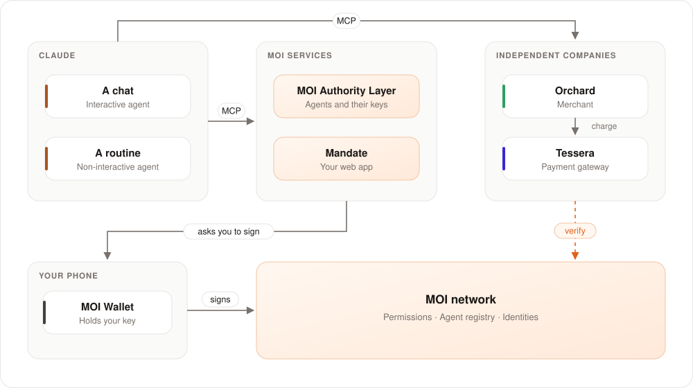
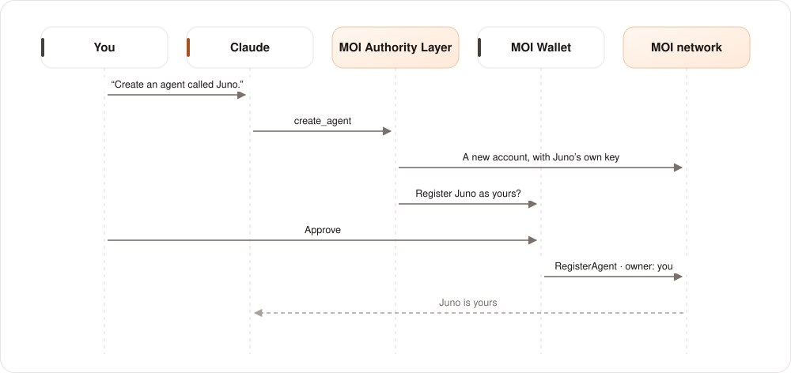
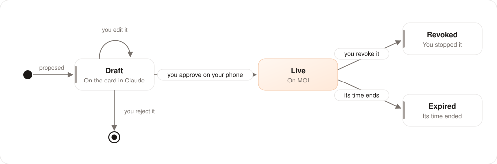
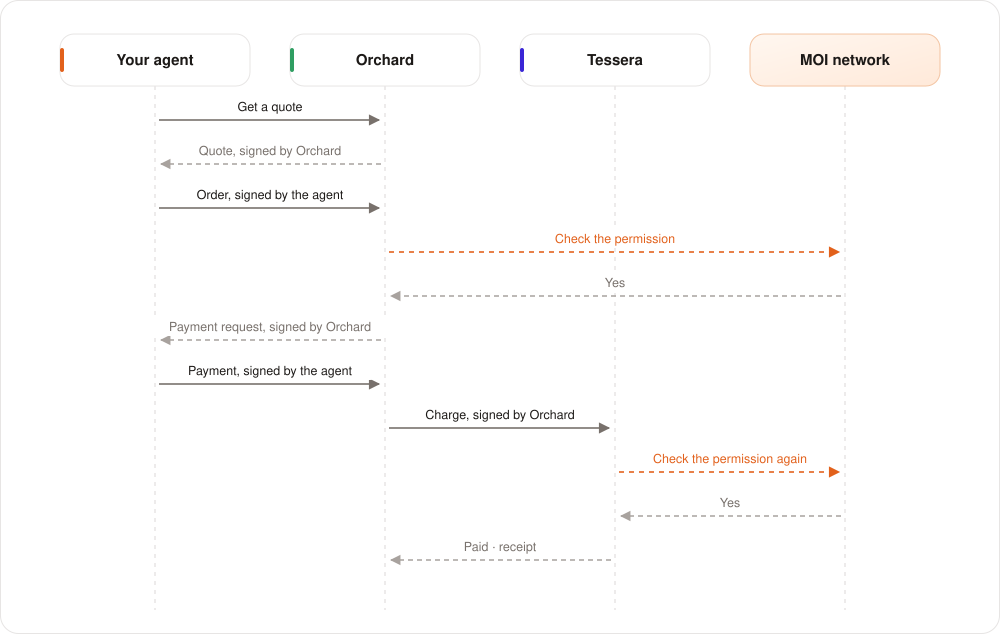
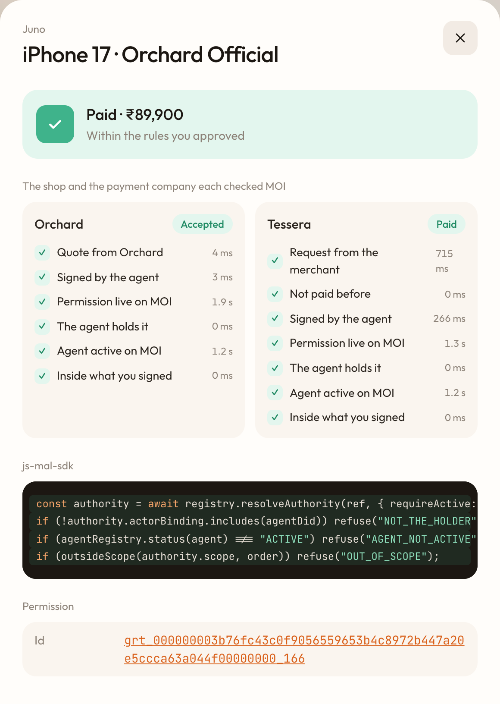
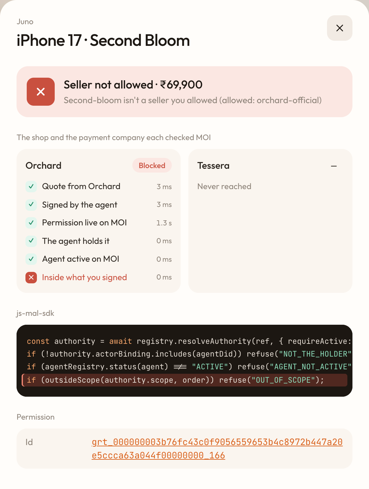
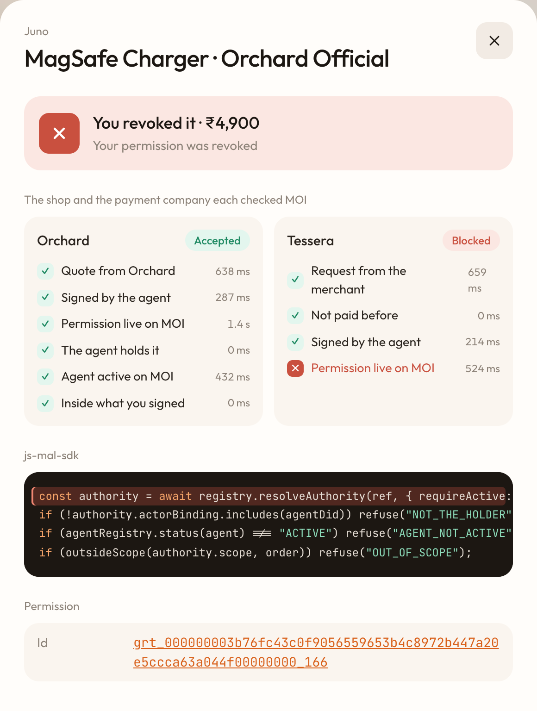
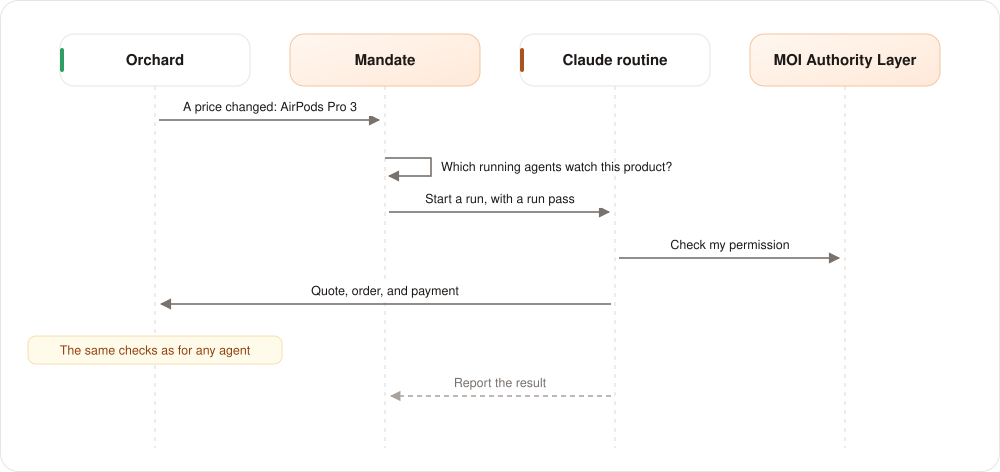

# How it works

[← The MAL Gateway](mal-gateway.md) · Next: [Walkthrough →](walkthrough.md)

This page follows one agent, Juno, from the moment it is created to the moment you take its permission away. Each step says what happens and why. The [walkthrough](walkthrough.md) shows the same steps screen by screen.

| Part | What it does |
|---|---|
| **MOI Wallet** | Holds your key on your phone. It signs your sign-in, your permissions, your revokes and your agents' registrations. |
| **MOI Authority Layer** | The connector you add to Claude or ChatGPT. It creates agents, keeps each agent's key, and sends anything that needs your signature to your phone. |
| **MAL Gateway** | Checks every agent call against your permission before it reaches a company. |
| **Mandate** | The web app. Your agents, your permissions, and every decision as it happens. You can revoke from here. |
| **Orchard** | A shop selling Apple products. It quotes, takes orders and asks for payment. |
| **Tessera** | Orchard's payment gateway. It takes the payment and issues the receipt. |
| **MOI network** | Keeps permissions, agent identities and the agent registry as public records. |

## 1. You connect your wallet

You add the MOI Authority Layer as a connector in Claude (or ChatGPT) and sign in once. Then you ask Claude to connect your wallet, scan a QR code with MOI Wallet, and approve a sign-in on your phone.

From then on, **you are your wallet account**, not your chat app. Connect the same wallet in Claude and in ChatGPT and you see the same agents and the same permissions in both.

## 2. You create an agent

You say "Create an agent called Juno" and pick whether it works with you in chat (interactive) or on its own (non-interactive).

- The service makes Juno a new key and a new MOI account, so Juno has its own identity, `did:moi:…`.
- Your phone registers Juno in the agent registry on MOI, with you as its owner.

A new agent can do nothing. If Juno tries to buy right now, the order is refused: **no permission**.

## 3. You give it a permission

You describe the permission in plain words:

> Give Juno a permission: iPhone 17 or MagSafe Charger from Orchard Official, up to ₹95,000 per order and ₹1,00,000 in total, for one hour.

Claude turns that into a **draft** and shows it on a card. Nothing is signed yet, and you can change any value on the card. When it looks right you press **Send to my phone**, approve in MOI Wallet, and the permission goes **live** on MOI. It ends when its time is up, or earlier if you revoke it.

Your phone shows the request as encoded data. The card shows the same request in plain words and tells you which request to look for.

## 4. The agent buys

You say "Buy me the iPhone 17." What follows works like a card payment: the shop asks for an exact amount, and the agent signs exactly that.

1. Orchard gives Juno a **quote**: ₹89,900, valid for five minutes, for Juno only.
2. Juno signs an **order** with its own key, naming the quote and its permission.
3. The order is checked against your permission. It passes, and Orchard sends back a **payment request** for exactly ₹89,900.
4. Juno signs that **payment**.
5. The payment is checked again, and Tessera pays Orchard and issues a **receipt**.

Every one of these messages is signed by whoever issued it, and anyone can check the signature against that account's key on MOI. Change one character and the signature breaks.

## 5. Every request is checked

Before Orchard accepts an order, and again before Tessera moves money, the request is checked from scratch against MOI. One failed check stops it, and the agent is told why.

**The order:**

| Check | Why it matters |
|---|---|
| The quote is Orchard's and still valid | The agent can't invent a price |
| The agent signed the order | Nobody else can order in its name |
| The permission is live on MOI | It wasn't revoked and hasn't run out |
| This agent holds it | A copied permission is useless to anyone else |
| The agent is registered and active | Its owner hasn't paused or retired it |
| The order fits what you signed | Product, seller, amount per order, total budget |

**The payment:**

| Check | Why it matters |
|---|---|
| It comes from a merchant Tessera serves | Nobody can send a made-up charge |
| This request wasn't paid before | Nothing gets paid twice |
| The agent signed exactly this payment | Nobody can change the amount or the payee |
| The permission is live, and the agent holds it | A revoke stops money at once, even after an order was accepted |
| The agent is registered and active | Its owner hasn't paused or retired it |
| The payment fits what you signed | Payee, amount and budget |

These are the token, grant-chain, scope and policy steps of the [MAL Gateway](mal-gateway.md#seven-checks-cheapest-first), applied to a shop and a payment.

## 6. When an order is outside the permission

Juno has spent ₹89,900 of its ₹1,00,000. Here is what happens to the next few requests:

| Juno tries | Result |
|---|---|
| Two iPhone 17s in one order (₹1,79,800) | Refused: over ₹95,000 per order |
| Another iPhone 17 as a separate order | Refused: ₹89,900 more would pass the ₹1,00,000 budget |
| An iPhone 18 Pro | Refused: not a product you allowed |
| A refurbished iPhone 17 from Second Bloom, ₹69,900 | Refused: not a seller you allowed |

It doesn't matter why the agent tried. Maybe you asked, maybe it misread you, maybe a listing talked it into it. The limits are on MOI, not in the model, and the request is refused the same way every time.

## 7. You revoke

You tap **Revoke** in Mandate, or tell Claude. Your phone signs the revoke and MOI records it. From the next request, every check that reads the permission gets "revoked". You don't change a key, you don't call a company, and nothing else you use stops working.

The timing matters. Say Juno orders a MagSafe Charger and Orchard accepts it. You revoke. Juno then signs the payment. The payment is checked against MOI again and refused, even though the order went through a minute earlier.

## 8. Agents that work on their own

A non-interactive agent, Falcon in the walkthrough, runs as a Claude routine with nobody watching.

- You give it a goal in your own words: "Buy two pairs of AirPods Pro 3 from Orchard Official, one at a time, when the price drops."
- When the price of that product changes at Orchard, Mandate starts Falcon's routine.
- Each run gets a **run pass** that lets it act as Falcon, and only as Falcon, for 20 minutes. A chat never gets one, so a chat can't act as Falcon.
- Falcon tries to buy, and reports what happened. It stops when the goal is met, or when you pause it.

A run is held to exactly the same checks as a chat. The model can be tempted by a cheaper seller or a listing written to trick it. It can make a mistake. The permission on MOI doesn't change, and neither do the answers.

## Fees, and what is real

You need no KMOI. On the public devnet the service pays the network fees for your writes, and keeps enough in your account to back the storage your permissions use.

| Real, on the MOI public devnet | Simulated |
|---|---|
| Your permissions and every revoke | Orchard's prices |
| Each agent's identity and its registration as yours | The money: Tessera keeps a ledger, and no value moves on chain |
| Every signature, and every check against MOI | |

Next: [Walkthrough →](walkthrough.md)
