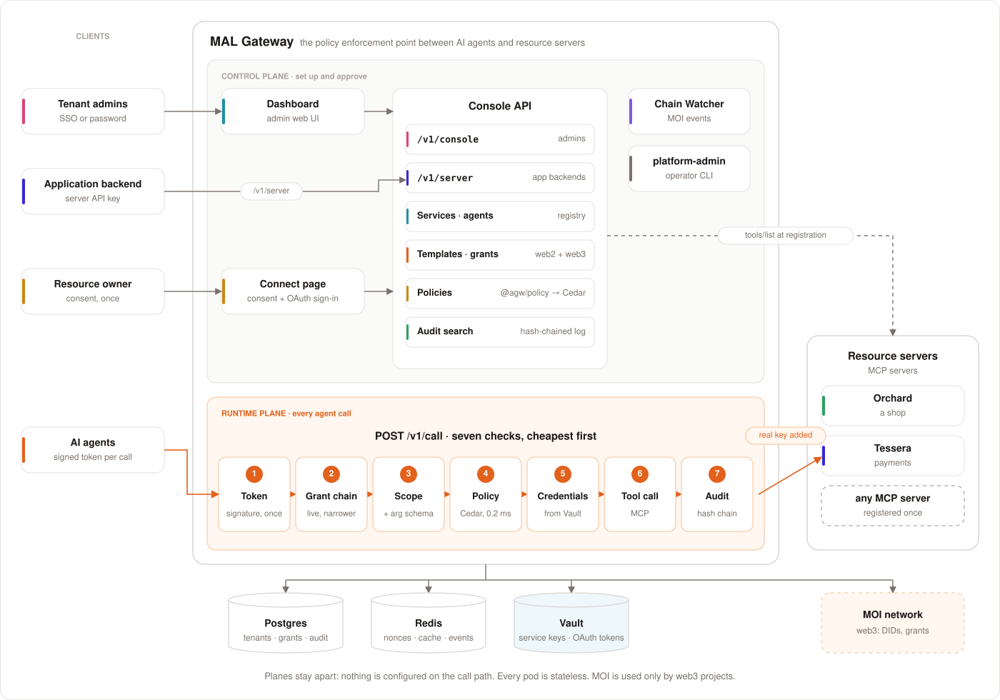
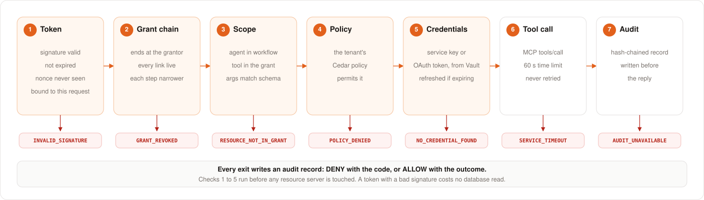
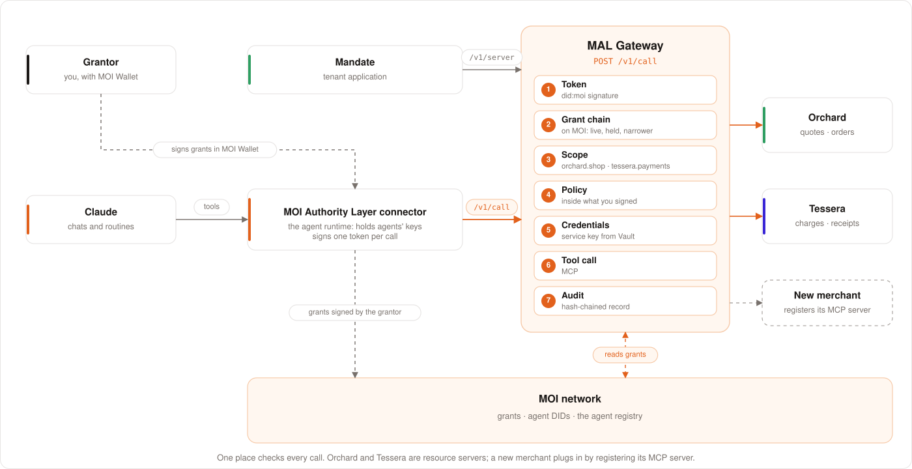

# The MAL Gateway

[← The MOI Authority Layer](moi-authority-layer.md) · Next: [How it works →](how-it-works.md)

The MOI Authority Layer can tell anyone whether a permission holds. Something still has to ask, on every single agent call, before the call reaches the service. That is the MAL Gateway: the one place where agent calls are checked, and the only door through which an agent reaches a company's tools.

## Why one place

Without a gateway, every service an agent calls has to do the work itself. The shop checks signatures and reads MOI. So does the payment provider. So does the CRM, the booking system, and the next service someone plugs in. Each of them keeps its own log, holds its own keys, and has its own chance to get a check wrong.

With the gateway, that work happens once:

- **Agents call the gateway, not the services.** Every call carries a token the agent signed for that one call.
- **The gateway checks the call** against the grant and the tenant's own policy.
- **It adds the real credentials** from a vault. Agents never see a service key or a user's token.
- **Every decision is written to a tamper-evident log**, allowed or denied, with the reason.

A tenant registers each of its MCP servers with the gateway once. It doesn't write a line of MOI code.

## The architecture

<p align="center"></p>

The gateway is split into two planes that never mix.

The **control plane** is where things are set up and approved. Tenant administrators use the Dashboard to register services and agents, write policies and search the audit log. The tenant's application backend uses the server API (`/v1/server`) to start an authorization or revoke one. A resource owner sees the Connect page once, to approve an agent and sign in to the service it will use. For projects on MOI, the Chain Watcher follows grants and revokes as they land on chain.

The **runtime plane** handles every agent call, and nothing is configured on that path. It is one endpoint, `POST /v1/call`, running seven checks in a fixed order. The pods hold no state of their own, so they scale out freely.

Underneath sit Postgres (tenants, grants, the audit log), Redis (nonces, cache, events) and Vault (service keys and resource owners' OAuth tokens). MOI is used by projects that keep identities and grants on chain.

## Seven checks, cheapest first

<p align="center"></p>

| | Check | What it makes sure of | Fails with |
|---|---|---|---|
| 1 | **Token** | The agent signed this exact request, recently, and never sent it before | `INVALID_SIGNATURE` |
| 2 | **Grant chain** | The grant traces back to the grantor, and every link is live and narrower than the one above | `GRANT_REVOKED` |
| 3 | **Scope** | This agent is in this workflow, this tool is in the grant, and the arguments match the tool's schema | `RESOURCE_NOT_IN_GRANT` |
| 4 | **Policy** | The tenant's policy allows it | `POLICY_DENIED` |
| 5 | **Credentials** | The real service key or user token is fetched from Vault, and refreshed if it is about to expire | `NO_CREDENTIAL_FOUND` |
| 6 | **Tool call** | The call goes to the service over MCP, once, with a time limit | `SERVICE_TIMEOUT` |
| 7 | **Audit** | A hash-chained record is written before the agent gets its answer | `AUDIT_UNAVAILABLE` |

The order matters. A token with a bad signature is turned away before a single database read. Nothing reaches a service until the first five checks pass, and every exit, allowed or denied, leaves an audit record.

## Two gates: the grant and the tenant policy

A call has to get past two separate gates.

The **grant** is what the grantor allowed this agent: these products, this seller, this much. The **policy** is the tenant's guardrail for every agent: market hours only, a second approval above a certain amount, never cancel every order at once. Both have to say yes.

Policies are written in [Cedar](https://www.cedarpolicy.com), the open policy language, and a decision takes about 0.2 ms. Here is Mandate's whole rule, "an agent may act only inside what you signed", as a policy:

```cedar
// An agent may buy only what you signed on your phone.
@id("buy-inside-your-permission")
permit (principal, action == Action::"buy", resource == Resource::"shop:order")
when {
  context.permission.products.contains(context.order.product) &&
  context.permission.sellers.contains(context.order.seller) &&
  context.order.amount <= context.permission.max_amount &&
  context.spent + context.order.amount <= context.permission.max_total
};

// An agent may pay only whom you signed for, within the same limits.
@id("pay-inside-your-permission")
permit (principal, action == Action::"pay", resource == Resource::"pay:charge")
when {
  context.permission.payees.contains(context.payment.payee) &&
  context.payment.amount <= context.permission.max_amount &&
  context.spent + context.payment.amount <= context.permission.max_total
};
```

Anything these two rules don't allow is denied. When a call is denied, the gateway names the condition that failed, so the agent, the tenant and the grantor all see *why*.

## Agents pass on less, never more

An agent can hand part of its work to another agent. The gateway follows the whole chain back to the grantor on every call, and each link can only narrow what it received. If the grantor revokes, every agent below loses access on its next call.

## Keys stay in the vault

Agents and application backends never hold a service key or a resource owner's token. Those live in Vault. The gateway adds the right one to a call only after all the checks above have passed, and a key that is about to expire is refreshed on the way.

## Runs where you need it

The MAL Gateway is our product, and it runs in two ways from the same code:

- **In our cloud.** We run it, scale it and keep it updated. You register your services and start.
- **In your own infrastructure.** You deploy it next to your services, and your keys, tokens and audit log stay on your side. It runs the same checks, with the same policies.

It also fits the permission setup a tenant already has. Projects on MOI keep identities and grants on chain, and the gateway reads them there. A tenant that doesn't use a blockchain at all keeps grants in the gateway itself and gets the same seven checks.

## Mandate on the gateway

<p align="center"></p>

Each part of the demo has a clear place in this picture:

| Part | Its role |
|---|---|
| **You, the grantor** | Sign grants with MOI Wallet. The gateway reads them from MOI. |
| **Claude** | Runs your agents, in a chat or as a routine on its own. |
| **MOI Authority Layer connector** | The agent runtime. It holds each agent's key and signs one gateway token per call. |
| **MAL Gateway** | Checks every call: the token, the grant on MOI, the scope, and the policy above. |
| **Orchard and Tessera** | The resource servers. They do what they're good at, quotes, orders, charges and receipts, and take calls that have already been checked. |
| **Mandate** | The tenant application. It shows your agents and every decision from the audit log, and revokes through the server API. |

A new shop that wants to sell to these agents doesn't build any of the checks. It registers its MCP server, and from the first call its orders come with the same guarantees as Orchard's.

Next: [How it works →](how-it-works.md)
