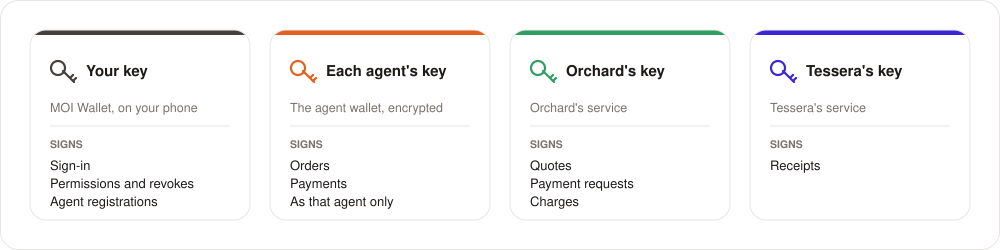

# The MOI Authority Layer

[← Why agents need authority](why-agents-need-authority.md) · Next: [The MAL Gateway →](mal-gateway.md)

The MOI Authority Layer (MAL) answers the third question: what an agent has been allowed to do. It is a protocol on the [MOI](https://moi.technology) network, and [`js-mal-sdk`](https://github.com/sarvalabs/js-mal-sdk) is the SDK any service uses to grant, check and revoke.

The idea is simple: an agent never gets a key that speaks for you. It gets a **permission**, a small public record that says exactly what you allowed. Every system the agent deals with reads that record for itself before it acts.

## A permission is a record, not a key

You sign a permission with MOI Wallet on your phone, and MOI keeps it. In the protocol it is called a **grant**. It holds five things:

| | What it says | Example |
|---|---|---|
| **From** | Who gives the permission | You, `did:moi:…` |
| **To** | Which agent may use it | Juno, `did:moi:…` |
| **Scope** | What the agent may do, and the limits | Buy iPhone 17 or MagSafe Charger, from Orchard Official, up to ₹95,000 an order and ₹1,00,000 in all. Pay only Orchard. |
| **Until** | When it ends on its own | In one hour |
| **Delegation** | Whether the agent may pass part of it on | No |

The example is Mandate's, but the scope can describe any action. For an agent that queries company data it could name the tables, the rows and read-only; for an agent that approves expenses, which claims and up to how much.

Nothing in that record can act on its own. It can't sign anything, and stealing it is useless: it names the one agent allowed to use it, and that agent has to prove who it is on every request.

The full record, as MOI stores it, is in the [developer guide](developers.md#a-permission-on-moi).

## Agents get their own identity

An agent in Mandate is not a nickname for your account. Each one gets its own MOI account, its own identity (`did:moi:…`) and its own key. It signs its orders and payments with that key, and only as itself.

When you create an agent, your phone registers it in the **agent registry** on MOI with you as its owner. As the owner you can pause or retire it there, and every verifier sees that too. You can look up any agent and its owner on the [Agent Explorer](https://agents.moi.technology). The registry has its own SDK, [`js-moi-agent-registry`](https://github.com/sarvalabs/js-moi-agent-registry).

<p align="center"></p>

| Key | Where it is | What it signs |
|---|---|---|
| **Your key** | MOI Wallet, on your phone | Your sign-in, your permissions and revokes, your agents' registrations, and a payment when you choose to pay yourself |
| **Each agent's key** | The agent wallet, encrypted. It never reaches the AI model. | Orders and payments, as that agent only |
| **Orchard's key** | Orchard's own service | Quotes, payment requests and charges |
| **Tessera's key** | Tessera's own service | Receipts |

Your key never leaves your phone. No service, and no agent, can sign as you.

## Checking a permission takes one call

A service that receives an order from an agent is a *verifier*. It asks MOI one question: is this permission real, live, and held by this agent? `js-mal-sdk` answers it in one call. Reads are free.

```ts
const authority = await registry.resolveAuthority(order.ref, { requireActive: true });

authority.grantorDid;    // who allowed it
authority.actorBinding;  // which agents may act on it
authority.scope;         // what it allows
```

If the permission was revoked, has expired, or belongs to someone else, the call says so, with a reason (`GRANT_REVOKED`, `GRANT_EXPIRED`, `UNKNOWN_GRANT`, …). The verifier then checks that the order fits the scope, and refuses anything it doesn't understand.

## Passing on less, never more

An agent can hand part of its permission to another agent, if you allowed that when you signed. The SDK only lets each step get narrower: fewer actions, lower limits, an earlier end. A wider request fails before anything is written. Revoking your grant ends everything below it, at once.

## Revoking is one record

When you revoke, your phone signs one small record and MOI keeps it. From the next request, every verifier that checks the permission gets "revoked". You don't rotate a key, you don't call anyone, and nothing else you use stops working.

## What MAL gives a service

- **Proof of consent.** For every action, a signed record of who allowed it and within what limits.
- **No shared secrets.** The service never holds a key that can spend a customer's money.
- **Instant revocation, for free.** It checks on each request, so it sees a revoke as soon as it happens.
- **Any agent, any AI.** The permission belongs to the grantor and the agent's identity, not to a chat app. The same agent can work in Claude today and somewhere else tomorrow.

MAL tells a service whether a permission holds. The next question is who asks it, on every call, and makes sure nothing slips past. That is the gateway's job.

Next: [The MAL Gateway →](mal-gateway.md)
