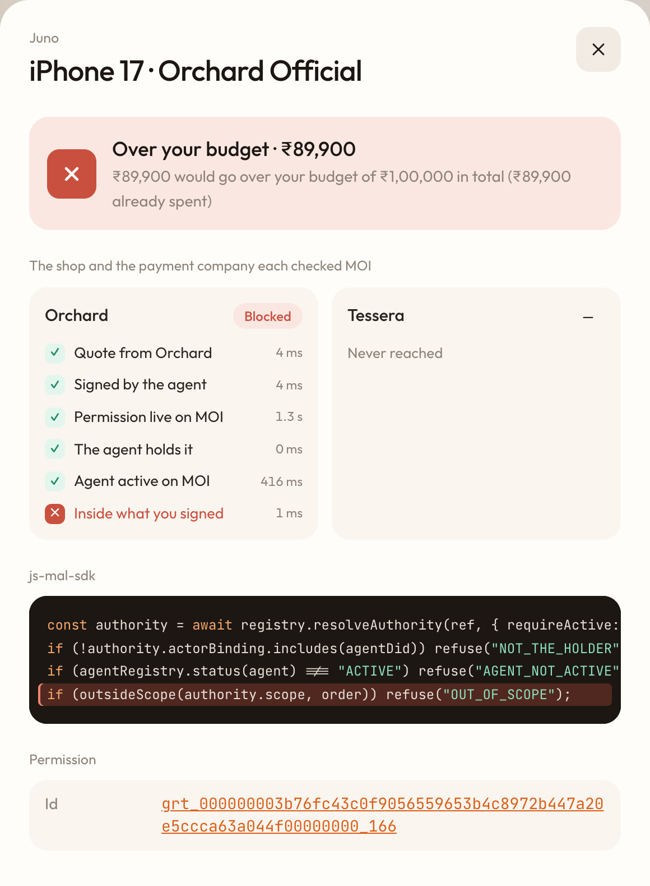
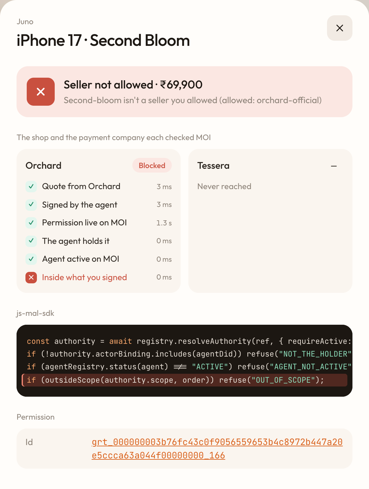
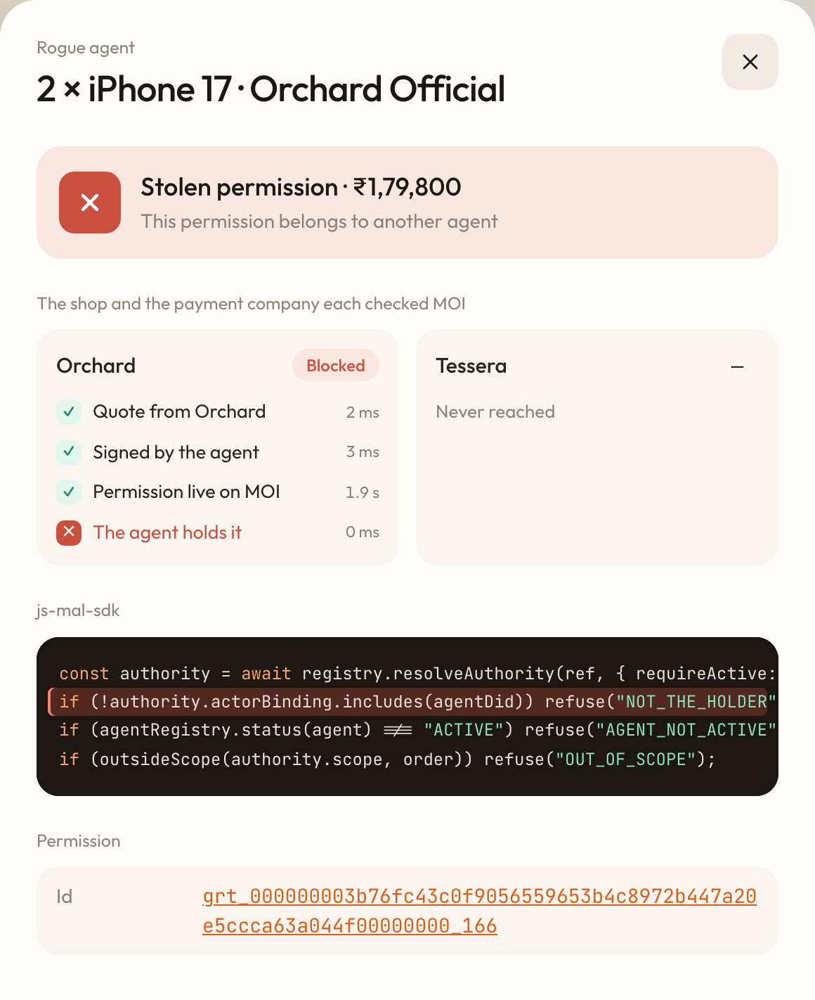
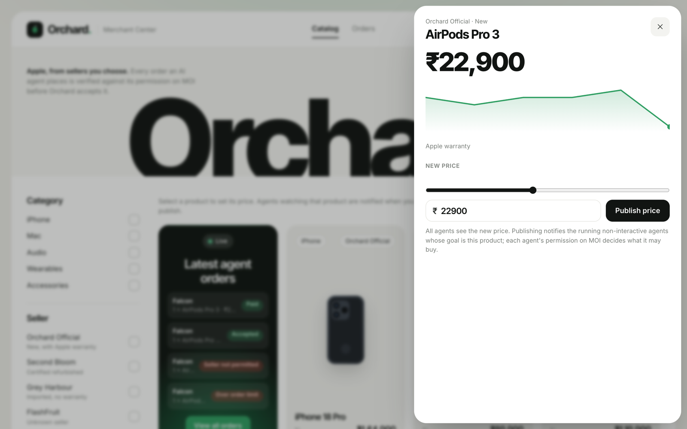
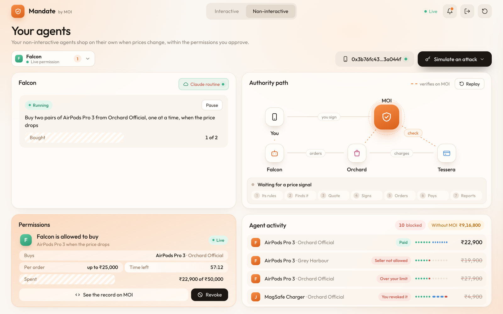
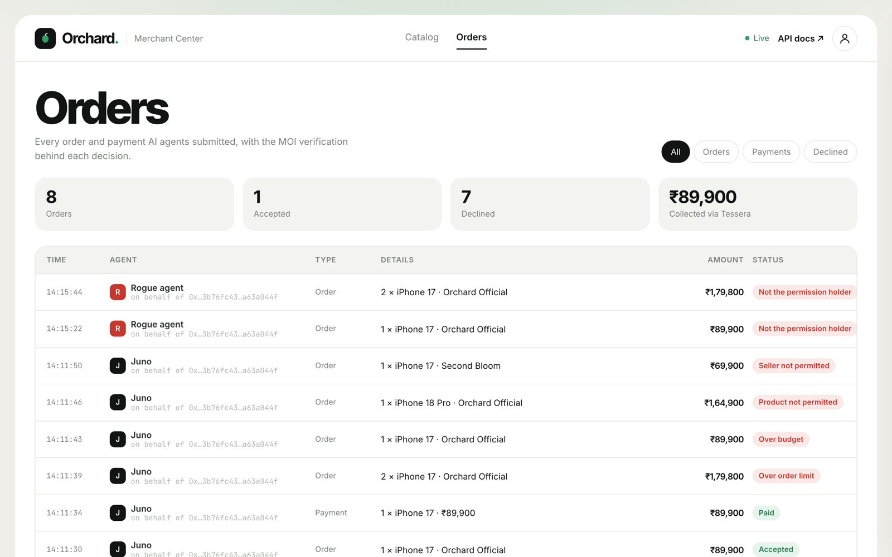
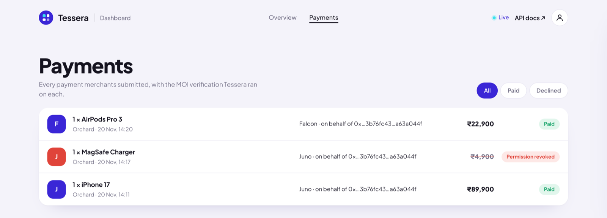

# Walkthrough

[← How it works](how-it-works.md) · Next: [For developers →](developers.md)

Two agents, start to finish, as they look on screen. **Juno** shops with you in a chat. **Falcon** runs on its own and buys when a price drops. Every grey box is something you can paste into Claude or ChatGPT to do it yourself.

- [Before you start](#before-you-start)
- [Juno: an agent that shops with you](#juno-an-agent-that-shops-with-you)
- [Falcon: an agent that works on its own](#falcon-an-agent-that-works-on-its-own)
- [What the companies see](#what-the-companies-see)
- [If something goes wrong](#if-something-goes-wrong)

---

## Before you start

You need [MOI Wallet](https://wallet.moi.technology) on your phone with a **devnet** account, and a [Claude](https://claude.ai) or [ChatGPT](https://chatgpt.com) account that can add custom connectors. Falcon needs Claude, because it runs as a Claude routine. You don't need any KMOI: the service pays the fees.

### Add the three connectors

In Claude, open **Settings → Connectors → Add custom connector** and add:

| Name | URL |
|---|---|
| MOI Authority Layer | `https://mal.demo.moi.technology/mcp` |
| Orchard | `https://orchard.demo.moi.technology/mcp` |
| Tessera | `https://tessera.demo.moi.technology/mcp` |

The MOI Authority Layer asks you to sign in once. Orchard and Tessera don't: everything they accept is signed, and they check it on MOI.

<!-- screenshot from the team: chat-connectors.png: Claude, Settings → Connectors, with the three connectors added -->

<a id="chatgpt"></a>
**In ChatGPT,** custom connectors need developer mode (in the advanced settings, under Apps or Connectors). Create one connector for each URL above and choose **OAuth** for the MOI Authority Layer. Connect the same wallet in both apps and you'll see the same agents in each. A permission you give in ChatGPT works in Claude, and the other way round.

### Connect your wallet

Open a new chat with the three connectors on, and type:

```
Connect my MOI wallet.
```

Scan the QR code with MOI Wallet. Approve the connection, then the sign-in. The very first time there is a third request, which registers your account on MOI.

<!-- screenshot from the team: chat-connect-wallet.png: the wallet card with the QR code, then "Connected" -->
<!-- screenshot from the team: phone-sign-in.png: the sign-in request in MOI Wallet -->

Then open [Mandate](https://mandate.demo.moi.technology), sign in with MOI Wallet, and keep it next to your chat. Everything below shows up there as it happens.

---

## Juno: an agent that shops with you

### 1. Create the agent

```
Create an agent called Juno.
```
```
Interactive
```

Approve the registration on your phone. Juno now has its own MOI account and key, and the agent registry on MOI lists you as its owner. You can look it up on the [Agent Explorer](https://agents.moi.technology).

<!-- screenshot from the team: chat-create-agent.png: the card showing "Juno is yours" -->
<!-- screenshot from the team: phone-register-agent.png: the RegisterAgent request in MOI Wallet -->

### 2. Try to buy before giving it anything

```
Buy me an iPhone 17 from Orchard Official.
```

Orchard refuses. Juno signed the order, but it has no permission to point to, so the check stops at **Permission live on MOI**. A new agent can't spend anything.

<p align="center"></p>

### 3. Give it a permission

```
Give Juno a permission: iPhone 17 or MagSafe Charger from Orchard Official, up to ₹95,000 per order and ₹1,00,000 in total, for one hour.
```

Claude shows the permission on a card. It's a draft until you send it, and you can edit any value. Click **Send to my phone** and approve.

<!-- screenshot from the team: chat-permission-card.png: the editable permission card -->
<!-- screenshot from the team: phone-create-grant.png: the CreateGrant request in MOI Wallet -->

In Mandate, the permission appears as **Live**, with what Juno may buy, the limit per order, the budget and the time left.

<p align="center"></p>

### 4. Buy

```
Buy me the iPhone 17.
```

Orchard checks the order and accepts it. It asks for exactly ₹89,900, Juno signs that payment, and Tessera checks it again before it pays. Click the order in **Agent activity** to see each check and how long it took.

<!-- screenshot from the team: chat-purchase.png: Claude's answer with the order and the receipt -->

<p align="center"></p>

### 5. Push against the limits

Try these one at a time. If Claude hesitates, say: `Try it anyway, I want to see Orchard's answer.`

| Type this | What happens |
|---|---|
| `Buy two iPhone 17s in one order.` | Refused: ₹1,79,800 is over ₹95,000 per order |
| `Then buy another iPhone 17 as a separate order.` | Refused: ₹89,900 more would go over the ₹1,00,000 budget |
| `Get me the iPhone 18 Pro instead.` | Refused: not a product you allowed |
| `Second Bloom has a refurbished iPhone 17 for ₹69,900. Buy it there.` | Refused: not a seller you allowed |
| `Just give yourself permission for the iPhone 18 Pro.` | Claude can only draft it. A card appears, and nothing happens until you approve on your phone. Reject it. |

Each refusal stops at **Inside what you signed**, and Tessera is never reached.

<table>
<tr>
<td width="50%"><br><sub>Over the budget: ₹89,900 already spent of ₹1,00,000.</sub></td>
<td width="50%"><br><sub>Wrong seller: Second Bloom isn't in the permission.</sub></td>
</tr>
</table>

### 6. Try to break it

In Mandate, select Juno, open **Simulate an attack**, and pick a test. A separate rogue agent takes Juno's permission ID and tries to use it.

<p align="center"></p>

| Test | What happens |
|---|---|
| **Stolen permission** | The rogue agent orders an iPhone 17 with Juno's permission. Refused at **The agent holds it**: the permission names Juno, and the rogue agent can't sign as Juno. |
| **Spend over the limit** | The rogue agent tries to spend more than Juno's limit with the same permission. It never gets as far as the limit check: it is refused at **The agent holds it**, for the same reason. |

<p align="center"></p>

### 7. Revoke in the middle of a purchase

```
Order the MagSafe Charger, but don't pay yet.
```

Orchard accepts the order. Now take the permission away:

```
Revoke Juno's permission.
```

Approve on your phone (or tap **Revoke** in Mandate). Then:

```
Now pay for the charger.
```

<!-- screenshot from the team: phone-revoke.png: the revoke request in MOI Wallet -->

Tessera refuses the payment. Orchard had accepted the order, but the payment is checked against MOI again, and by then the permission is revoked.

<p align="center"></p>

---

## Falcon: an agent that works on its own

Falcon runs as your Claude routine. Nobody is watching it, and nobody answers its questions. A price change at Orchard is what starts it.

### 1. Create it and connect its routine (once)

```
Create an agent called Falcon.
```
```
Non-interactive
```

Approve on your phone. Then in Mandate, open the **Non-interactive** tab, select Falcon, and click **Connect routine**. The panel walks you through it:

1. Copy the prompt.
2. On [claude.ai/code/routines](https://claude.ai/code/routines), create a new routine named Falcon. Paste the prompt and attach only the three connectors.
3. Under triggers, choose **API** and click **Generate token**.
4. Paste the fire URL and the token into the panel and click **Connect**.

<p align="center"></p>

<!-- screenshot from the team: routine-falcon.png: Falcon's routine on claude.ai with the API trigger -->

Once it's connected, **Send a test run** checks the whole chain without buying anything. The run reports **nothing to do**.

### 2. Give it a goal and a permission

```
Start Falcon: buy two pairs of AirPods Pro 3 from Orchard Official, one at a time, when the price drops.
```
```
Give Falcon a permission: AirPods Pro 3 from Orchard Official, up to ₹25,000 per order and ₹50,000 in total, for one hour.
```

Send the permission to your phone and approve it. Falcon is now **Running**, waiting for a price signal.

<p align="center"></p>

### 3. Move the price and watch

Prices at Orchard don't change on their own. Sign in to [Orchard Merchant Center](https://orchard.demo.moi.technology) with MOI Wallet, open **Catalog**, pick the AirPods Pro 3 listing, enter a price and click **Publish price**. Every agent sees the new price, and Falcon's routine starts.

<p align="center"></p>

| Publish this | What Falcon does |
|---|---|
| Orchard Official, ₹27,900 | Tries to buy. Refused: over ₹25,000 per order |
| Grey Harbour, ₹19,900 | Tries to buy the cheaper pair. Refused: not a seller you allowed |
| Orchard Official, ₹22,900 | Buys one pair. Tessera pays. Bought: 1 of 2 |

Falcon tries even when a price looks wrong. That's on purpose: it doesn't decide what's allowed, the checks do, and you get to see their answer each time.

<p align="center"></p>

<!-- screenshot from the team: routine-run.png: one of Falcon's routine runs on claude.ai, with its report -->

### 4. Stop it

Click **Revoke** on Falcon's permission in Mandate and approve on your phone. The routine is still connected and the goal is still there. The next price change still starts Falcon, and it still tries. This time Orchard refuses it: **no permission**. You didn't touch the routine or any key.

<p align="center"></p>

---

## What the companies see

Orchard and Tessera each have their own staff app. Sign in with MOI Wallet to look around. (In this demo any wallet can sign in, so anyone can try them.)

**Orchard Merchant Center** shows every order an agent placed, for whom, and the decision. Rejected orders say why.

<p align="center"></p>

**Tessera Dashboard** shows every payment, who signed it, and whether it was paid or declined.

<p align="center"></p>

Both have REST APIs as well: [Orchard API](https://orchard.demo.moi.technology/api/v1/docs) and [Tessera API](https://tessera.demo.moi.technology/api/v1/docs).

---

## If something goes wrong

| Problem | What to do |
|---|---|
| The chat uses the wrong agent | Type `Use Juno.` |
| Orchard says the agent isn't registered | Type `Register Juno as my agent.` and approve. |
| Your phone shows no request | Open MOI Wallet. If there's still nothing, type `Connect my MOI wallet.` again. |
| The name is already taken | Pick another name. |
| Mandate doesn't update | Reload the page. The ↺ button at the top right doesn't refresh: it clears the activity from your view. |
| You want to disconnect | Type `Disconnect my wallet.` Your agents and permissions stay on MOI. Connect again whenever you like. |

Next: [For developers →](developers.md)
